# MotionDisco: Motion Discovery for Extreme Humanoid Loco-Manipulation

**LLM-driven search over contact plans for long-horizon humanoid loco-manipulation.**

MotionDisco discovers whole-body motions for a humanoid robot that walks,
climbs and moves objects over long horizons. A language model writes
candidate **contact plans**: which foot, hand and object touches which surface
in each mode. An evolutionary tree search refines those plans using feedback
from a hierarchy of solvers. Plans that survive are optimized into dynamically
feasible robot and object trajectories, which can then be re-solved under
randomized physics to build tracking datasets.

[Paper](https://arxiv.org/abs/2606.06139) ·
[Video](https://youtu.be/DHiVz34QYlw) ·
[Installation](#installation) ·
[Usage](#usage) ·
[Examples](#examples) ·
[Gallery](#motion-gallery) ·
[Task guide](examples/loco_manipulation/README.md) ·
[Citation](#citation) ·
[License](#license)

Research code accompanying **[MotionDisco: Motion Discovery for Extreme Humanoid Loco-Manipulation](https://arxiv.org/abs/2606.06139)** (CoRL 2026)<br>
Ilyass Taouil, Michal Ciebelski, Shafeef Omar, Haizhou Zhao, Angela Dai, Aaron M. Johnson, and Majid Khadiv

MotionDisco is built on **[FARO](https://github.com/Atarilab/faro)**, a
contact-explicit trajectory optimizer that jointly optimizes motion, contact
forces and timing for robots and objects. FARO answers "is this contact plan
feasible, and what is the motion?". MotionDisco answers "which contact plan
should we try?" for tasks too long to enumerate by hand, with 30 to more than
100 contact modes.

| Sorting four boxes from a pallet (113 modes) | Cycling three parcels between shelves (76 modes) |
| --- | --- |
| 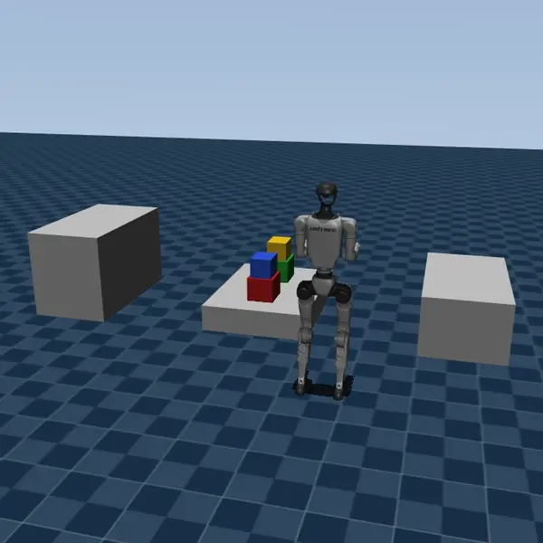 | 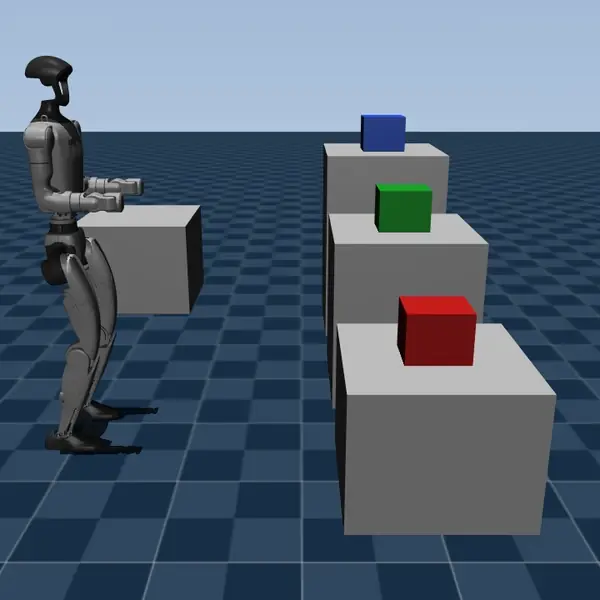 |
| **Unloading a truck and stacking (63 modes)** | **Carrying a parcel up a staircase (39 modes)** |
| 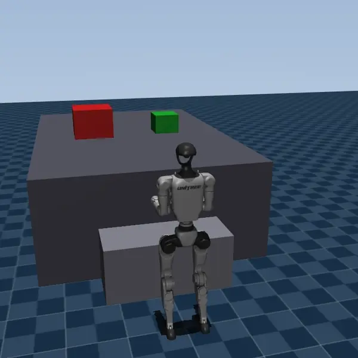 | 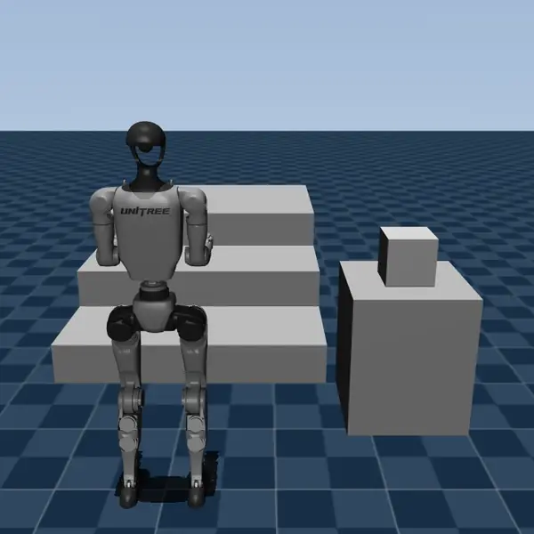 |

| Standing a tall carton under a low bay (33 modes) | Long crate around an L-shaped divider (32 modes) | Laying a carton flat under a low bay (30 modes) |
| --- | --- | --- |
| 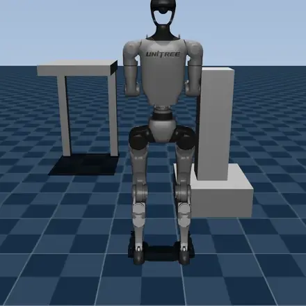 | 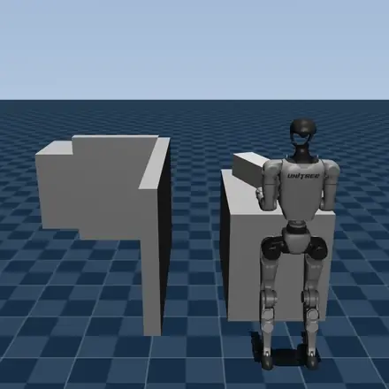 | 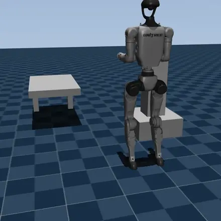 |

Each motion is a single contact plan found by the search and solved with
whole-body trajectory optimization, shown sped up. More in the
[motion gallery](#motion-gallery).

## How it works

A candidate is a short Python program, `generate_contact_plan(scene)`, that
builds a contact-mode sequence with `walk(plan, n_steps)` and
`append_mode(plan, left_ee=..., box=...)`. Each candidate goes through a
cascade of increasingly expensive checks. The first stage that fails returns
plain-language feedback to the LLM, phrased in the plan's own vocabulary.

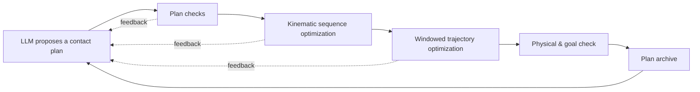

1. **Plan checks:** reject malformed schedules, duplicate plans, plans over
   the horizon cap and over-represented strategy families before any solver
   runs.
2. **Kinematic sequence optimization (KSO):** FARO's geometric check of the
   whole sequence. It runs on the first window for long plans and is
   warm-started for level changes (climbing on and off tables and steps).
3. **Trajectory optimization (TO):** FARO's whole-body TO, solved left to right
   in windows cut at manipulation events, with lookahead, a per-run window
   cache, automatic insertion of extra walking steps where strides are too
   long, and fail-fast at the first failing window.
4. **Validity:** a trajectory counts if it converges or passes an independent
   physical check (centroidal dynamics, joint and torque limits, contact
   friction, pull, gap and slip, MuJoCo penetration), *and* the objects reach
   their task goal.
5. **Search:** valid and partial plans enter an island-based archive.
   Diversity mode keys the archive on the set of contacts a plan uses, so the
   search returns distinct strategies rather than variants of one.

## Capabilities

- **Long-horizon contact planning.** Plans with 30 to 100+ modes covering
  pick-and-place, carrying, stacking, unstacking, climbing with objects and
  multi-box sorting.
- **Actionable solver feedback.** KSO and TO violations, grasp reachability
  probes, grip and stride diagnostics, and goal misses are translated into
  edits the LLM can make ("add `walk(plan, 2)` before mode 31").
- **Scalable evaluation.** Segmented and incremental TO with window caching,
  bucketed KSO horizons and per-scene solver code generation make 100-mode
  plans tractable to evaluate inside a search.
- **Strategy diversity.** Descriptor archive, novelty scores and a proposal
  filter push the search toward different contact strategies per scene.
- **Scene campaigns.** Run the search over many scenes, easiest first, until
  each has N unique valid plans or hits its time cap.
- **Dataset generation.** Re-solve every valid plan under randomized object
  mass, object size, timing and start offsets, and export MuJoCo-ready
  trajectories for training whole-body trackers.

## Motion gallery

More plans discovered by MotionDisco across the benchmark and generated
scenes, each solved as one whole-body trajectory.

| Clearing boxes out of the way (24 modes) | Carrying a box over a table (43 modes) | Carrying a box up two platforms (38 modes) |
| --- | --- | --- |
| 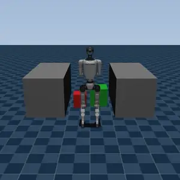 | 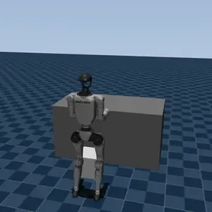 | 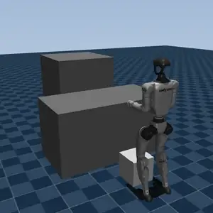 |
| **Climbing onto a table with a box (28 modes)** | **Long-distance pick and place (26 modes)** | **Assembling a two-carton stack (26 modes)** |
| 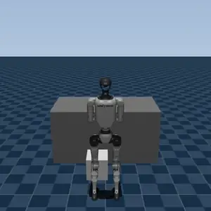 | 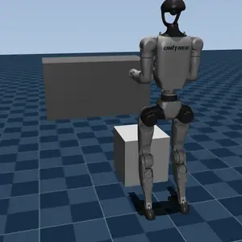 | 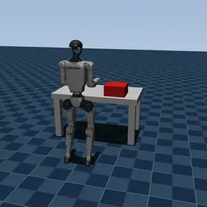 |
| **Long crate across a partition (25 modes)** | **Standing a crate on its end (25 modes)** | **Retrieving a box from under a table (24 modes)** |
| 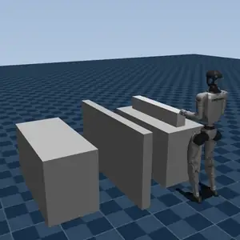 | 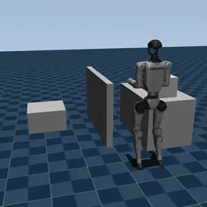 | 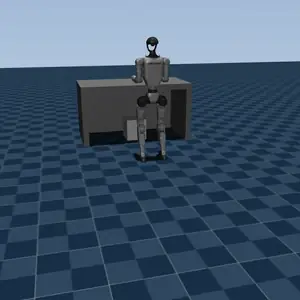 |
| **Turning a parcel upright in place (23 modes)** | **Swapping two parcels on a counter (22 modes)** | **Stepping off a box, then moving it (21 modes)** |
| 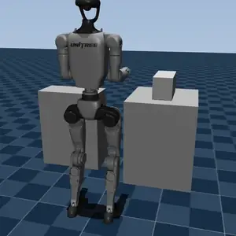 | 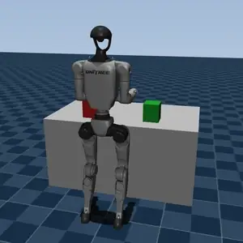 | 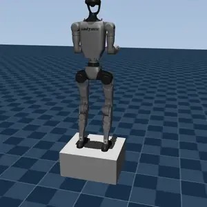 |
| **Transfer from a raised loading dock (19 modes)** | **Packing two parcels side by side (19 modes)** | **Retrieving a carton from a low rack (18 modes)** |
| 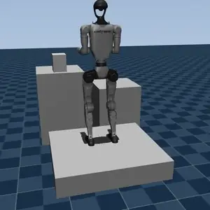 | 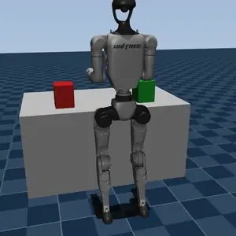 | 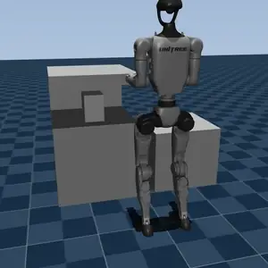 |

## Installation

### 1. Clone with submodules

```bash
git clone --recurse-submodules git@github.com:Atarilab/MotionDisco.git
cd MotionDisco
# already cloned without --recurse-submodules:
git submodule update --init --recursive
```

FARO is checked out at `submodules/faro`.

### 2. Install FARO

Follow FARO's [`install.md`](https://github.com/Atarilab/faro/blob/main/install.md)
from inside `submodules/faro`. Name the environment `motiondisco`
wherever the guide says `faro_env`, since one environment holds both
projects. The guide builds acados and moto and installs FARO in editable
mode.

### 3. Install MotionDisco into the same environment

```bash
conda activate motiondisco
pip install -e .
```

The LLM backend reads API keys from a `.env` file in the repository root or
the launch directory (`ANTHROPIC_API_KEY`, `OPENAI_API_KEY`,
`GEMINI_API_KEY`). A model prefixed `claude-max/` uses a logged-in
`claude` CLI subscription instead of an API key (see
[`docs/support_claude_max.md`](docs/support_claude_max.md)).

> First use of a scene compiles the solvers: about 20 min of moto code
> generation per scene and goal mode, plus one acados build per KSO horizon
> bucket. Both are cached for later runs.

## Usage

A task is a **scene** plus a natural-language **description**. Scenes are
dotted IDs into FARO's scene registry (`motiondisco.box_stacking`,
`motiondisco.long_dist_pick_place`, ...) or MotionDisco's own scenes under
[`examples/loco_manipulation/scenes`](examples/loco_manipulation/scenes).

```bash
conda activate motiondisco

# One search on one scene, 40-program budget
motiondisco_launch task=loco_manipulation cluster=local \
    task.scene=motiondisco.box_stacking \
    task.description="'Stack the boxes on the table.'" \
    evo_config.num_generations=40

# Diversity search: distinct contact strategies, quality scoring
motiondisco_launch task=loco_manipulation variant=loco_diverse cluster=local \
    task.scene=motiondisco.climb_table_with_box task.score_mode=quality

# Evaluate a single hand-written plan, no search
cd examples/loco_manipulation
python evaluate.py --program_path initial.py --results_dir results/manual_eval
```

Each run writes `results/<exp_name>/<run>/` containing a SQLite program
archive and one `gen_N/results/` per candidate with `metrics.json`,
`extra.json` (plan, solver status, feedback) and, when the solvers were
reached, `ik_run.pkl` / `to_run.pkl`.

```bash
# Browse the search tree, scores and plan diffs in the browser
motiondisco_visualize results --open

# Replay a trajectory in MuJoCo (no acados needed); writes an mp4 next to it
python examples/loco_manipulation/replay_to_run.py <run>/gen_7/results/to_run.pkl
```

The [task guide](examples/loco_manipulation/README.md) documents scoring,
solver settings, feedback channels and every environment variable.

## Examples

| Task | Entry point |
| --- | --- |
| Single search | `motiondisco_launch task=loco_manipulation task.scene=<scene>` |
| Search over several scenes, with resume | [`run_search.sh`](examples/loco_manipulation/run_search.sh) |
| Multi-scene campaign, until N valid plans per scene | [`scene_campaign.py`](examples/loco_manipulation/scene_campaign.py) `--scenes motiondisco.long_dist_pick_place motiondisco.box_stacking --valid 5 --hours 4` |
| Physics-randomized re-solves of valid plans | [`generate_dataset.py`](examples/loco_manipulation/generate_dataset.py) · [`dataset_export.py`](examples/loco_manipulation/dataset_export.py) |
| Search followed by dataset generation | [`data_campaign.py`](examples/loco_manipulation/data_campaign.py) [`campaigns/example.yaml`](examples/loco_manipulation/campaigns/example.yaml) |
| Strategy diversity of a run | [`diversity_report.py`](examples/loco_manipulation/diversity_report.py) `<run>` |
| Replay | [KSO](examples/loco_manipulation/replay_ik_run.py) · [TO](examples/loco_manipulation/replay_to_run.py) |

Benchmark scenes (FARO `motiondisco.*`): `long_dist_pick_place`,
`under_table_pick_place`, `box_stacking`, `move_through_clutter`,
`climb_table_with_box`, `climb_table_up_down_with_box`,
`parkour_pick_place_1`, `parkour_pick_place_2`, `banana_real`.

## Repository layout

| Path | Contents |
| --- | --- |
| [`examples/loco_manipulation/`](examples/loco_manipulation) | The loco-manipulation task: evaluator, solver wrappers, feedback, campaigns, dataset tools, scenes |
| [`submodules/faro/`](https://github.com/Atarilab/faro) | FARO: scenes, KSO and TO |
| `shinka/` | Search engine: runner, LLM clients, program archive, prompts, configs, web UI |
| [`docs/`](docs) | Engine documentation (configuration, CLI, web UI, LLM backends) |
| `tests/` | Unit tests (`pytest -m "not requires_secrets"`) |

## Citation

If you use MotionDisco in your research, please cite:

```bibtex
@inproceedings{taouil2026motiondisco,
  title={MotionDisco: Motion Discovery for Extreme Humanoid Loco-Manipulation},
  author={Taouil, Ilyass and Ciebelski, Michal and Omar, Shafeef and Zhao, Haizhou and Dai, Angela and Johnson, Aaron M. and Khadiv, Majid},
  booktitle={Conference on Robot Learning (CoRL)},
  year={2026},
  eprint={2606.06139},
  archivePrefix={arXiv},
  primaryClass={cs.RO},
  url={https://arxiv.org/abs/2606.06139}
}
```

## License

MotionDisco is licensed under the [Apache License 2.0](LICENSE).
Copyright 2026 the MotionDisco authors.

The search engine in `shinka/` is derived from
[ShinkaEvolve](https://github.com/SakanaAI/ShinkaEvolve) (Copyright 2025
Sakana AI, Apache 2.0). [`NOTICE`](NOTICE) lists the files we modified.
FARO and other third-party code and assets keep their own licenses.
